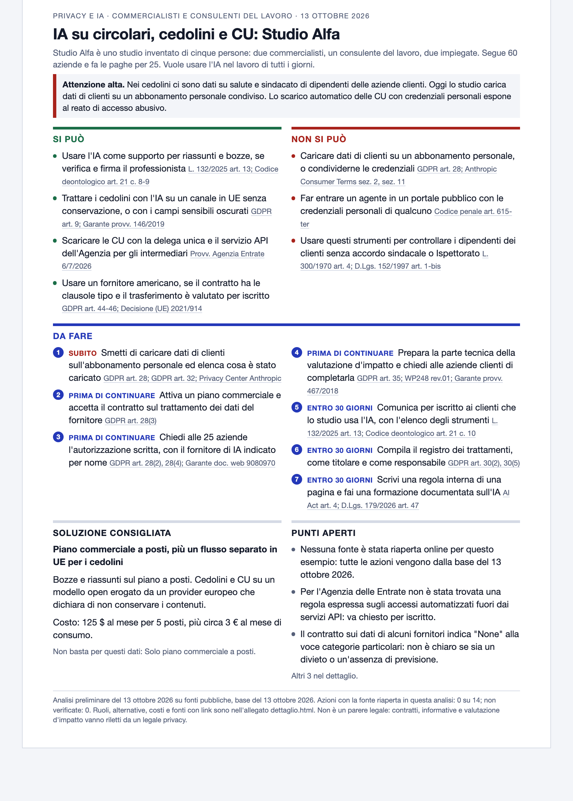

# ai-privacy-check

Una skill per Claude Code che fa l'analisi preliminare di privacy e regole sull'IA per un caso d'uso concreto, in Italia e nell'UE. Le descrivi cosa vuoi fare con l'IA e su quali dati, e ti consegna un rapporto di una pagina: cosa si può fare, cosa non si può, cosa va fatto, ogni voce con la sua norma. Più la soluzione tecnica che regge e quanto costa a listino.

*L'esempio in [`examples/fictional/`](examples/fictional/) è inventato: studio, persone e numeri non esistono.*



## Cosa fa

Parti da un caso, per esempio:

- "Uno studio di commercialisti vuole far leggere i cedolini a un modello di IA."
- "Un poliambulatorio vuole trascrivere le visite e compilare i portali dei fondi."
- "Uno studio legale vuole riassumere i fascicoli, anche penali."

La skill fa prima alcune domande, poi lavora in sette passi:

| Passo | Cosa succede |
|---|---|
| Domande iniziali | Settore, cosa deve fare l'IA, che dati passano, per conto di chi si lavora, strumenti, volumi |
| Inquadramento | Nove segnali (dati particolari, lavoratori, portali di terzi, dati fuori UE, IA che parla con le persone e altri) e catena dei ruoli |
| Regole | Le regole che si applicano al caso, prese da una base di 334 affermazioni verificate, diventano azioni di tre tipi: si può, non si può, da fare. Se lo strumento è già in uso, prima cosa fermare e come rimediare |
| Ricontrollo mirato | Riapre online solo le fonti che pesano sul caso e segna ogni azione come ricontrollata, dalla base o non verificata |
| Soluzioni e costi | Piano commerciale, modello in cloud UE, modello open source in locale, con i costi calcolati da uno script |
| Validazione | Uno script impone il livello minimo di attenzione, la copertura delle norme, i limiti che tengono il rapporto in una pagina, e rifiuta le frasi che promettono troppo |
| Consegna | Un rapporto di una pagina, un allegato di dettaglio e la sintesi in chat |

Il rapporto sta su un foglio A4: livello di attenzione con i motivi, cosa si può, cosa non si può, cosa va fatto in ordine di urgenza, soluzione consigliata con il costo, primi punti aperti. Ogni voce porta la sua norma. L'allegato contiene il resto: chi fa cosa, il perché e la fonte datata di ogni azione, le alternative, i costi, tutti i punti aperti.

## Cosa non è

È un'**analisi preliminare su fonti pubbliche, non un parere legale**. Non dice mai che qualcosa è "conforme" o "a posto": dice cosa prevede la norma, cosa fare e cosa resta aperto. Contratti, informative e valutazione d'impatto vanno riletti da un legale privacy. Rapporto e allegato lo scrivono.

La skill guarda e scrive. Non firma, non invia, non configura account e non entra in portali.

Copre in dettaglio tre settori: commercialisti e consulenti del lavoro, sanità, avvocati. Per gli altri applica le regole generali e lo dichiara. Vale per Italia e UE.

## La base di conoscenza

La base sta in `references/` e in `data/affermazioni.json`. È stata costruita il 13 ottobre 2026: per ogni dominio un ricercatore automatico ha riaperto le fonti e un secondo controllore ha provato a smentire ogni affermazione. Contiene 334 affermazioni in otto domini (diritto UE, diritto italiano, professioni, sanità, fornitori di IA, open source e costi, trascrizione e interfacce, punti legali aggiunti dopo le prime prove): 315 confermate e 19 corrette dal secondo controllo, nessuna smentita.

Limiti da conoscere:

- molte pagine sono state lette tramite uno strumento che ne restituisce una sintesi: numeri, importi e commi vanno ricontrollati sul testo prima di un uso contrattuale;
- i testi europei sono stati letti in inglese;
- le sentenze dei tribunali sono state lette su riviste;
- prezzi e termini dei fornitori valgono alla data di lettura.

Norme e listini cambiano in fretta. Per questo ogni azione porta nell'allegato la data della fonte, e se la base ha più di 90 giorni e nulla è stato ricontrollato il rapporto mostra un avviso.

Per cercare nella base senza aprirla:

```bash
python3 -B scripts/fonti.py norma "GDPR art. 28" --breve
python3 -B scripts/fonti.py cerca "conservazione zero"
python3 -B scripts/fonti.py aperti sanita
python3 -B scripts/costi.py --persone 5 --token-in 20 --token-out 4 --solo-delicati
python3 -B scripts/costi.py --minuti-audio 9000
```

## Installazione

```bash
git clone https://github.com/Matteoikarieth96/ai-privacy-check-skill.git
ln -s "$(pwd)/ai-privacy-check-skill" ~/.claude/skills/ai-privacy-check
```

Poi, in Claude Code: `/ai-privacy-check`, oppure descrivi il caso e la skill si attiva da sola.

Servono solo Python 3.9 o successivo. Nessuna dipendenza.

## Riservatezza

Descrivi il caso, non incollare documenti o nomi veri: la skill te lo ricorda all'inizio. Le analisi finiscono in `~/ai-privacy-check/<nome-del-caso>/`, fuori da qualunque repository. Dettagli in [SECURITY.md](SECURITY.md).

## Struttura

```
SKILL.md              istruzioni per il modello
references/           regole generali, tre settori, fornitori, open source, costi, punti aperti
data/                 affermazioni verificate e listini, con fonte e data
scripts/              fonti.py, costi.py, validate.py, build_report.py
templates/            modello di report.json
examples/fictional/   un caso inventato, con rapporto e allegato costruiti
docs/                 l'immagine del rapporto di esempio
tests/                python3 -m unittest discover -s tests
```

## Test

```bash
python3 -m unittest discover -s tests
```

## Altre skill

- [evm-dd](https://github.com/Matteoikarieth96/evm-dd-skill): due diligence su progetti crypto ed EVM dal punto di vista di un investitore
- [hiring-prep](https://github.com/Matteoikarieth96/hiring-prep-skill): preparazione a un colloquio, con guida e quiz
- [whiteboard-video](https://github.com/Matteoikarieth96/whiteboard-video-skill): video esplicativi disegnati a mano, con voce
- [beer-can-label](https://github.com/Matteoikarieth96/beer-can-label-skill): etichette per lattine di birra con anteprima 3D
- [3d-print-design](https://github.com/Matteoikarieth96/3d-print-design-skill): pezzi parametrici per la stampa 3D
- [skill-release](https://github.com/Matteoikarieth96/skill-release-skill): pubblicare una skill su GitHub senza far trapelare nulla, con scansione automatica e revisione indipendente
- [breadboard-wiring-guide](https://github.com/Matteoikarieth96/breadboard-wiring-guide-skill): collegamenti passo passo su breadboard per Arduino UNO, con un disegno e l'avviso USB a ogni passo

## Versioni

Vedi [CHANGELOG.md](CHANGELOG.md).

## Licenza

MIT. Vedi [LICENSE](LICENSE).
